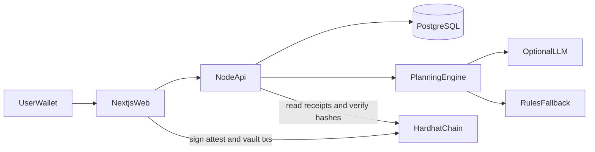

# Architecture

The platform is a local desk for household planning, hash attestations, and a demo token vault.

## Off chain

PostgreSQL holds the user, session, profile, accounts, goals, canonical snapshot, plan text, and the receipt metadata after a successful check.

Amounts are integer cents. The planning engine computes net worth, savings rate, asset mix, and a goal gap from a fixed month length of 30.44 days. It does not assume an investment return.

`packages/shared` canonicalizes JSON by sorting object keys and hashing the UTF-8 bytes with keccak256. The API stores that canonical string. The browser hashes the same string before the wallet signs, and the verification route hashes it again.

Sign-in is a wallet signature over a one-time message. The API checks the recovered address, marks the nonce used, and sets an HttpOnly session cookie. Profile routes require that cookie.

## On chain

Deployment is local Hardhat, chain id 31337.

- `PlatformRegistry` — a wallet registers itself, sets a consent flag, and appends attestations. Each record stores the caller, a content hash, a record type, and a timestamp. Empty hashes revert. The subject is always `msg.sender`.
- `DemoAsset` — an ERC-20 with a one-time faucet. The token is a local demo balance.
- `PlanningVault` — an ERC-4626 vault whose asset is `DemoAsset`. Deposit and withdraw use OpenZeppelin's guarded implementation.

The chain does not receive income, account names, or plan text. It receives the wallet address, the consent scope, and the hash.

## Verification

`POST /snapshots/:id/prepare` returns the hash, record type, consent scope, and registry address. The user signs `register`, `setConsent`, and `attest`. `POST /chain/confirm` reads the receipt, decodes `Attested`, and checks the subject, hash, record type, and registry address before saving the record.

`GET /snapshots/:id/verification` recomputes the hash from the stored canonical JSON and reads the receipt again. The UI shows the snapshot as verified only when that live read matches.

Vault deposits and withdrawals are signed in the browser. The API confirms the receipt status, signer, and target contract. Displayed positions come from `balanceOf` and `convertToAssets`.

## Boundaries

The demo key shipped for local sign-in is Hardhat account #1, a published test key. The web app throws if that key would be used on any chain other than 31337 or against a non-loopback RPC. The API does not hold a signing key and does not submit transactions.

Restarting the Hardhat node clears chain state. Run the deploy script again so `deployments/local.json` matches the new addresses.
